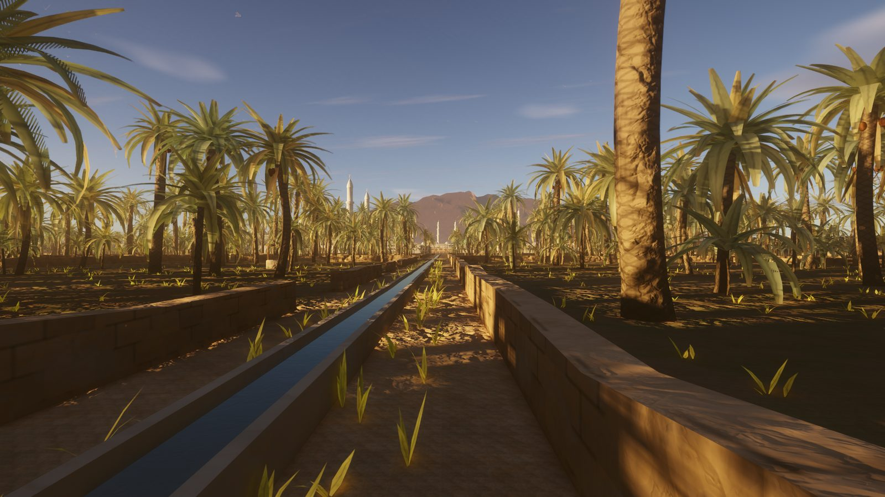
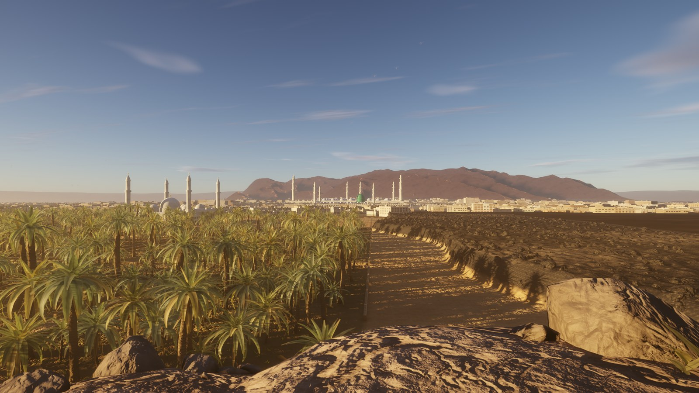
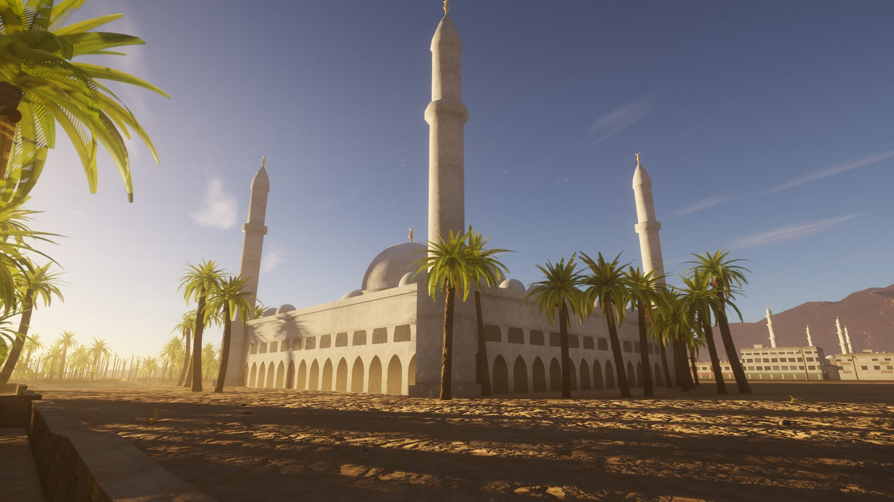
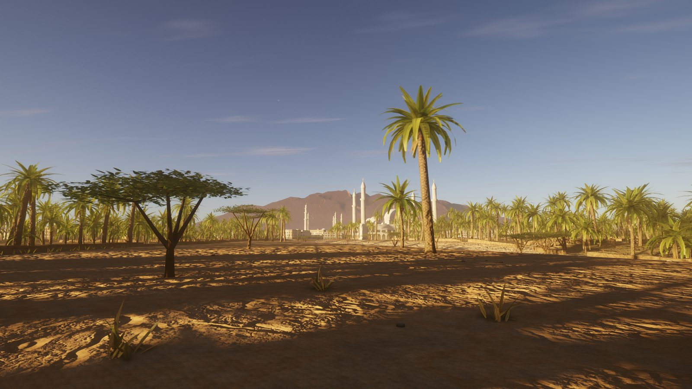
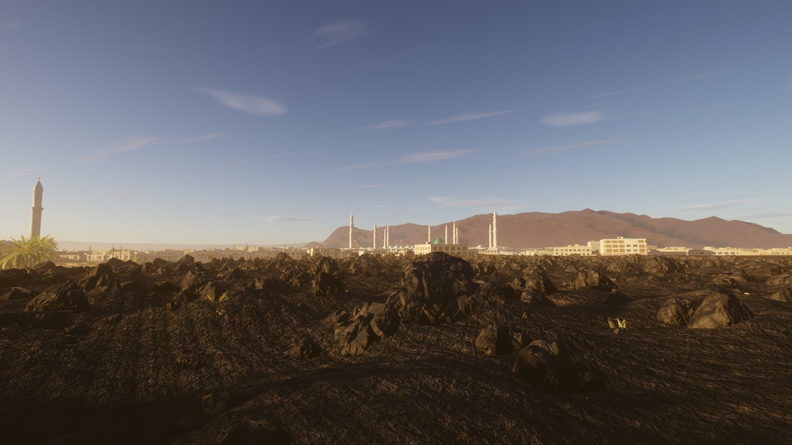
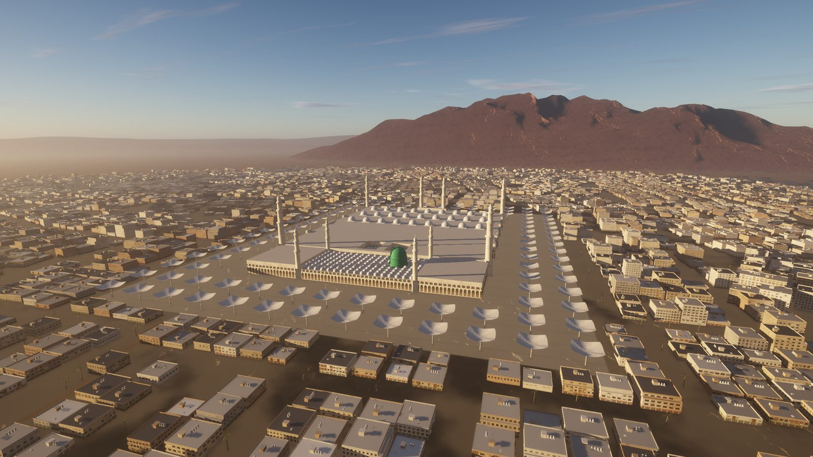

# Madinah Horizon

<p align="center">
  <a href="https://moeymakes.github.io/madinah-horizon/"></a>
</p>
<p align="center"><b><a href="https://moeymakes.github.io/madinah-horizon/">moeymakes.github.io/madinah-horizon/</a></b><br>
<sub>Chrome or Edge on a desktop or laptop (needs WebGPU) · nothing to install · one HTML file</sub></p>

**Walk through the date gardens around Madinah at golden hour, right in your browser.**

Palm groves with mud-brick walls and still irrigation channels, the black lava of the harrat, a sandy wadi,
a white domed mosque in the style of Masjid Quba, and on the horizon the minarets of the Prophet's Mosque in
front of Mount Uhud. Everything is made by code: no images, no 3D models, no sound files. The whole world is
**one HTML file** of about 93 KB.

The geography is composed and compressed so it fits in one view, and the buildings are respectful
approximations, not replicas. There are no people in the scene, and nothing is recited.

[](https://moeymakes.github.io/madinah-horizon/)

| | |
|---|---|
|  |  |
|  |  |



## Try it

1. Open **[https://moeymakes.github.io/madinah-horizon/](https://moeymakes.github.io/madinah-horizon/)** in **Chrome** or **Edge** on a desktop computer, or download
   [`index.html`](index.html) and open it from your computer (it works offline).
3. Wait a few seconds while the land is built, then press **Enter** and start walking.

It works offline. It needs a browser with **WebGPU**.

## What's there

- **Date palms** in walled gardens: heavy fronds that sway together with their trunks, date clusters, dead
  fronds hanging along the trunks, grass along the water channels, a stone well
- **The harrat**: a field of black basalt with a rubble front, sparse dry shrubs
- **A wadi** of pale sand and cobbles with flat-topped acacias
- **A granite hill** to climb for the view north
- **A white mosque** with arcades, a great dome, smaller domes and four minarets, ringed by palms
- **On the horizon**: the Prophet's Mosque with its tall minarets, silver roof domes, the Green Dome and the
  courtyard umbrellas, a low cream city around it, and the long red granite massif of Uhud beyond
- **Life**: pigeons circling, dust and pollen drifting in the low sun
- **Sound** made up as you listen: wind and gusts, rustling fronds, doves, small birds

## Controls

| | Keyboard & mouse |
|---|---|
| Look around | Move the mouse (or drag with the left button where the mouse cannot be captured) |
| Walk | `W` `A` `S` `D` |
| Run | Hold `Shift` |
| Fly / walk | `F`, or `E` to lift off from walking |
| Up / down | `E` / `Q` (descending onto the ground lands you back to walking) |
| Jump to a viewpoint | `1` to `6` |
| Menu | `Esc` |
| Sound on / off | `M` |
| Sound mix | **Garden**, **Wind**, **Birds**, **Calm** or **Off** in the menu, plus a volume slider (remembered next visit) |
| Performance stats | `H` |
| Detail level | **Low**, **Medium** or **High** in the menu (reloads the page) |

**On a touchscreen:** hold one finger down to walk forward and slide it to look around; a second finger runs;
the ✈ button toggles flight.

## How it works

- The ground model (heights, lava, granite, wadi, city and groves) is one function evaluated on the graphics
  card when the page opens: at 1 m over the walkable land and at about 23 m over 24 km of surroundings.
- The walkable land is a 3D density field turned into a mesh, so the lava front and the rocks can overhang.
- The far landscape is a ring-shaped mesh out to 12 km with soft shadows baked from the low sun.
- Palm fronds are built in the vertex shader; their leaflets are cut out per pixel and anti-aliased with
  alpha-to-coverage.
- Everything is drawn with **WebGPU** directly. No engine or 3D library.
- The method, the verification loop and the page structure follow
  [Abyssal Garden](https://github.com/noniv/abyssal-garden) (MIT), via the `worldsmith` skill.

## Make it your own

Source is in [`source`](source). Rebuild with Node.js 18+:

```bash
cd source && npm install && npm run build
```

| File | What's inside |
|---|---|
| [`source/src/world.js`](source/src/world.js) | Layout: gardens, channels, the two mosques, the city, palms, rocks, birds, viewpoints and the camera path |
| [`source/src/shaders.js`](source/src/shaders.js) | The ground model, sky and haze, materials, palm fronds, sun shafts and the final image |
| [`source/src/main.js`](source/src/main.js) | Renderer, walking and flying, collision, controls |
| [`source/src/audio.js`](source/src/audio.js) | The soundscape |
| [`source/src/quality.js`](source/src/quality.js) | Detail levels |
| [`source/template.html`](source/template.html) | The page: loading bar, menu, controls list |

`npm run build:dev` writes `dev.html` with a scripted one-minute flight (`P`) and a benchmark (`B`).

## Other worlds in this series

- **[Nabawi Courtyard](https://moeymakes.github.io/masjid-nabawi-courtyard/)**: the marble plaza of the Prophet's Mosque up close, as the great umbrellas open ([source](https://github.com/moeymakes/masjid-nabawi-courtyard))
- **[Madinah, First Years](https://moeymakes.github.io/madinah-first-years/)**: the oasis and the first mosque around 622-632 CE, an artistic reconstruction ([source](https://github.com/moeymakes/madinah-first-years))

## License

MIT. Parts adapted from Abyssal Garden (MIT); its notice is in `source/LICENSE-abyssal-garden`.
